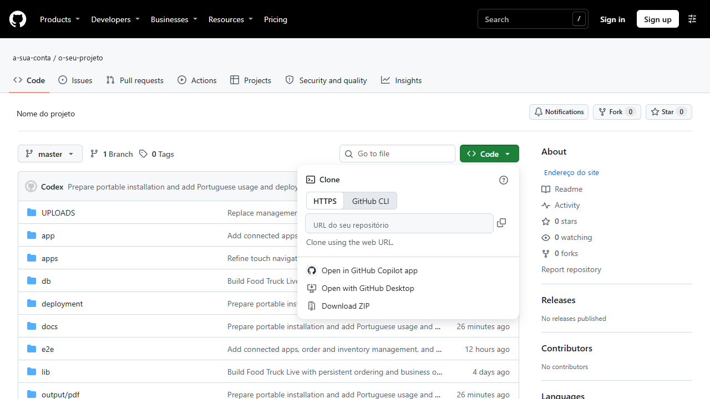
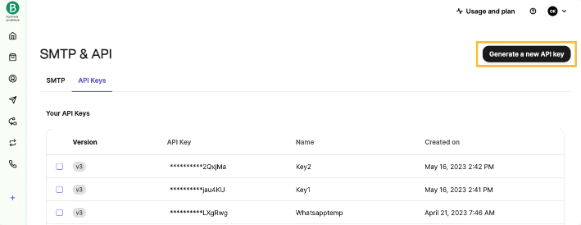
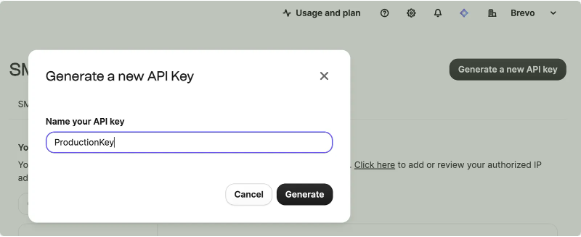
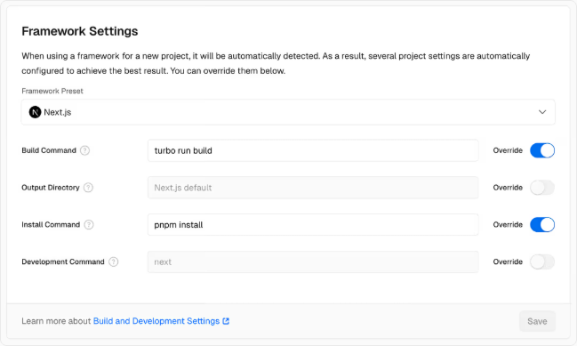
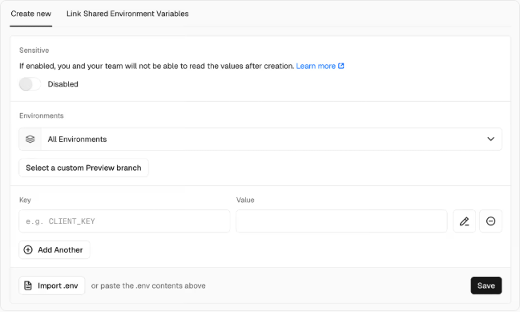
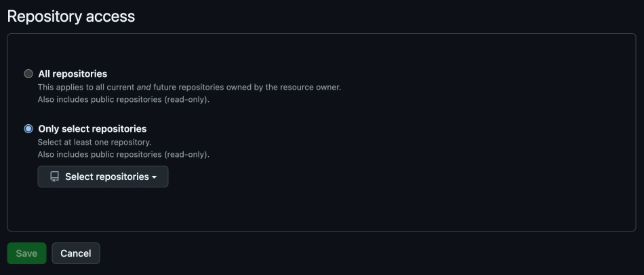
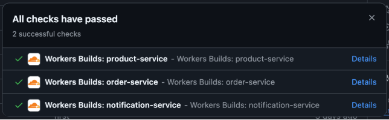

# Instalar o Food Truck Live, passo a passo
Food Truck Live | Guia ilustrado para principiantes | 3 de novembro de 2026

Este manual começa do zero. Não precisa de saber programar. Leia um capítulo de cada vez, faça os passos e confirme o resultado antes de continuar. As palavras em inglês correspondem aos nomes dos botões dos sites.

## 1. O que vai instalar
No fim terá dois endereços na internet. Um é para os clientes escolherem a carrinha e fazerem encomendas. O outro é para a equipa gerir produtos, ingredientes, eventos e pedidos.

A aplicação precisa também de um serviço que trata os pedidos e de um lugar onde guardar os dados. Vamos preparar estas partes, uma a uma.

| Nome que encontrará | Explicação simples |
| Site dos clientes | A montra e o balcão de encomendas. |
| Gestão | A área de trabalho da equipa, protegida por palavra-passe. |
| API | A parte que liga os sites aos dados e executa as operações. O cliente não tem de a abrir. |
| Base de dados | Um arquivo organizado: guarda produtos, contas, stock e encomendas. |
| Imagens | Ficheiros das fotografias e logótipos, guardados separadamente dos dados. |

Uma instalação nova começa vazia. Não recebe contas ou encomendas da instalação de outra pessoa. Mais tarde vai criar a sua própria conta de administrador e a primeira carrinha.


## 2. Para que serve cada serviço
Não são cinco maneiras de fazer a mesma coisa. Cada serviço tem uma tarefa.

| Serviço | Para que vai servir |
| GitHub | Guarda os ficheiros que fazem a aplicação funcionar. Pense numa pasta do projeto na internet. |
| Supabase | Guarda a base de dados e as imagens. É onde os dados ficam mesmo quando fecha o computador. |
| Brevo | Envia os emails de confirmação e de recuperação de palavra-passe. |
| Vercel | Põe os dois sites e a API a funcionar na internet. |
| Cloudflare | Alternativa para alojar os sites ou gerir um endereço próprio. Não é necessário no percurso principal. |

Neste manual, comece por GitHub, Supabase, Brevo e Vercel. Siga os capítulos 3 a 18 pela ordem indicada. Os capítulos Cloudflare e alojamento próprio são alternativas: leia-os só se escolher esse caminho.

Ter conta num serviço não cria automaticamente os outros. Por exemplo, criar Supabase não publica os sites; criar Vercel não cria a base de dados.

Pode fazer pausas entre capítulos. Guarde os acessos num gestor de palavras-passe e anote em que passo ficou. Não precisa de comprar um domínio para testar: os serviços fornecem endereços próprios.

## 3. Criar a sua conta GitHub e copiar o projeto
GitHub é o site onde ficam os ficheiros da aplicação. Um «repositório» é simplesmente a pasta do projeto nesse site. «Fork» significa fazer uma cópia para a sua conta.

1. Abra https://github.com no navegador.
2. Carregue em Sign up, que significa criar conta. Se já tem conta, use Sign in, que significa entrar.
3. Preencha os dados pedidos e confirme o email recebido. Guarde o seu nome de utilizador.
4. Depois de entrar, abra o repositório da aplicação através do endereço que lhe foi fornecido por quem partilhou o projeto.
5. No topo do projeto, procure Fork e carregue nesse botão.
6. No campo Owner, escolha a sua conta. Pode manter o nome de projeto sugerido ou escolher outro.
7. Carregue em Create fork e aguarde.

Como confirmar: a página do projeto mostra a sua conta como proprietária da cópia e o nome de projeto que escolheu.

Se Fork não aparecer, confirme que entrou na conta. Não crie ficheiros novos manualmente e não altere os ficheiros que já lá estão para continuar esta instalação.

Esta conta GitHub não é o login da gestão Food Truck Live. A conta da aplicação será criada no capítulo 12.

## 4. Descarregar e abrir a pasta no computador
Um ZIP é um conjunto de ficheiros guardados dentro de um único ficheiro. Antes de usar os ficheiros, é preciso extraí-los.

1. Na sua cópia GitHub, carregue no botão verde Code.
2. No menu que abre, escolha Download ZIP.
3. Abra a pasta Transferências do computador e encontre o ficheiro descarregado.
4. No Windows, carregue nele com o botão direito e escolha Extrair tudo. No macOS, abra o ZIP com duplo clique.
5. Escolha uma pasta que consiga encontrar facilmente. Por exemplo, Documentos > FoodTruckLive.
6. Abra a pasta extraída. Se só vir outra pasta dentro, abra essa segunda pasta.
7. Confirme que vê o ficheiro package.json e as pastas apps e services. Essa é a pasta principal do projeto.

Não trabalhe dentro da janela do ZIP. Os ficheiros têm de estar extraídos numa pasta normal.



Como confirmar: consegue abrir package.json na pasta normal do computador. Não precisa de compreender o seu conteúdo.

## 5. Instalar duas ferramentas no computador
Vai usar Node.js para executar a preparação e Visual Studio Code para abrir os ficheiros e escrever os comandos. Não precisa de comprar extensões nem de usar inteligência artificial.

1. Abra https://nodejs.org. Procure a versão 24 e descarregue o instalador adequado ao seu sistema, Windows ou macOS.
2. Execute o instalador e conclua os passos. Pode manter as opções habituais. Se pedir reinício, faça-o.
3. Abra https://code.visualstudio.com e descarregue Visual Studio Code para o seu sistema.
4. Instale e abra o programa. «Visual Studio Code» é o nome completo; não é necessário instalar o programa maior chamado «Visual Studio».
5. No programa, escolha File > Open Folder, ou Ficheiro > Abrir pasta.
6. Escolha a pasta principal que identificou no capítulo 4. À esquerda devem aparecer apps, services e package.json.
7. Se aparecer uma pergunta de confiança, confirme apenas porque abriu a cópia do projeto que acabou de obter.

Como confirmar: vê os ficheiros numa coluna à esquerda do Visual Studio Code. Não abra ficheiros de uma pasta com o mesmo nome que ainda esteja dentro do ZIP.

Em Linux, use os instaladores/instruções oficiais para Node.js 24 e Visual Studio Code. As etapas seguintes dentro do editor são semelhantes.

## 6. Usar o terminal, sem saber programar
O terminal é uma pequena janela onde escreve uma instrução e carrega em Enter. Cada instrução neste manual está numa caixa cinzenta. Copie só a instrução, não a palavra «sh» nem as aspas do texto à volta.

1. No Visual Studio Code, abra Terminal > New Terminal, ou Terminal > Novo terminal.
2. No Windows, se puder escolher o tipo, escolha Command Prompt / Linha de comandos. Isto evita um bloqueio frequente do PowerShell ao executar npm.
3. Escreva a primeira instrução e carregue em Enter:

```sh
node --version
```

4. Deve aparecer um número que começa por v24. Se disser que não conhece node, feche e abra o editor depois da instalação; confirme que instalou Node.js 24.
5. Execute agora:

```sh
npm ci --include=dev
```

O programa vai buscar as peças de software de que a aplicação precisa. Aguarde até voltar a aparecer a linha onde pode escrever. Não feche a janela enquanto trabalha. Avisos não são sempre erros; se o comando terminar com erro, veja o capítulo 26.

6. Execute:

```sh
npm run install:init
```

Como confirmar: aparece um ficheiro chamado .env.install na coluna da esquerda. Se o programa disser que já existe, não o apague; abra o ficheiro existente. O nome começa mesmo por um ponto.

## 7. Criar o projeto Supabase
Supabase é onde vai guardar os dados e as imagens. PostgreSQL é o nome do tipo de base de dados usado pela aplicação; não é outra conta para criar.

1. Abra https://supabase.com/dashboard.
2. Crie conta ou entre. Pode usar a opção de entrar com GitHub, se preferir.
3. Se pedir uma organização, crie uma com o nome do seu negócio ou projeto. É apenas a forma de agrupar os seus projetos nessa conta.
4. Escolha New project / Novo projeto.
5. Dê-lhe um nome fácil de reconhecer, por exemplo foodtruck.
6. Crie uma palavra-passe forte para a base e guarde-a. Esta é a palavra-passe administrativa da base; não é a da gestão da aplicação.
7. Escolha uma região próxima da utilização, por exemplo uma região europeia para Portugal.
8. Confirme o plano escolhido e crie o projeto. Aguarde até o painel estar pronto.

Como confirmar: o painel mostra o projeto criado e permite abrir as opções Database, Storage e SQL Editor.

Se estiver a fazer uma instalação nova, crie um projeto novo. Não use este manual para apagar ou reiniciar um projeto que já tenha encomendas.

## 8. Preparar uma área privada para os dados
SQL é o nome da linguagem usada para dar instruções à base de dados. Não precisa de a aprender: neste passo vai copiar um pequeno texto fornecido pelo projeto.

Um «esquema» é uma área organizada dentro da base. Vamos chamar-lhe foodtruck. Vamos também criar o acesso foodtruck_app, usado só pela aplicação.

1. Crie e guarde uma segunda palavra-passe aleatória, com pelo menos 32 caracteres, usando letras e números. Não use uma frase previsível. Usar só letras/números evita problemas ao colar esta palavra-passe nos endereços do passo seguinte.
2. No Supabase, abra SQL Editor e escolha New query / Nova consulta.
3. No Visual Studio Code, abra a pasta deployment e o ficheiro postgres-bootstrap.sql.example.
4. Copie o conteúdo para o SQL Editor do Supabase.
5. Substitua apenas SUBSTITUIR_POR_SEGREDO_UNICO pela segunda palavra-passe. Mantenha as duas plicas que ficam à volta dela. Não escreva essa palavra-passe num manual ou mensagem.
6. No fim, acrescente esta linha, própria do Supabase:

```sql
REVOKE ALL ON SCHEMA foodtruck FROM anon, authenticated;
```

7. Carregue em Run / Executar. Se aparecer um aviso sobre alterações de permissões, confirme que está no projeto novo criado no capítulo 7 e que copiou este ficheiro.

Como confirmar: aparece uma mensagem de sucesso, sem erro. Não repita este passo se disser que o utilizador ou esquema já existe; pode significar que o passo já foi feito. Não apague os dados para tentar novamente.

Guarde a segunda palavra-passe com a indicação «acesso foodtruck_app». A primeira palavra-passe era do administrador da base; são acessos diferentes.

## 9. Preparar o lugar das imagens
O Supabase Storage é um armário online para ficheiros. Vamos criar um armário privado para as fotografias enviadas pela gestão.

1. No painel Supabase, abra Storage.
2. Carregue em New bucket / Novo bucket.
3. Escreva exatamente foodtruck-media como nome.
4. Deixe o bucket privado, sem acesso público, e confirme.
5. Abra Project Settings / Definições do projeto e procure API Keys ou API Keys & JWT.
6. Localize a chave de servidor chamada service_role ou secret. Copie-a para o seu gestor de palavras-passe.
7. Não use a chave publishable/anon. Ela é pública e não dá o acesso que a API precisa.

Esta chave permite ao servidor guardar e ler imagens. Não a envie a ninguém, não a coloque nos sites dos clientes ou da gestão e não a guarde no GitHub.

Como confirmar: em Storage aparece foodtruck-media. Não precisa de criar pastas dentro dele; a aplicação trata disso.

## 10. Preparar o email de confirmação
Brevo envia mensagens quando um cliente cria uma conta ou pede para recuperar a palavra-passe. Sem este passo, essas mensagens não chegam.

1. Abra https://onboarding.brevo.com/account/register e crie uma conta gratuita.
2. Confirme o email que usou para criar a conta.
3. No painel Brevo, adicione como remetente o endereço de email que quer usar. Abra a mensagem de verificação e confirme-o.
4. No Brevo, abra SMTP & API > API Keys.
5. Carregue em Create a new API key / Criar chave API e dê-lhe um nome, por exemplo Food Truck Live.
6. Copie a chave mostrada e guarde-a no gestor de palavras-passe. O Brevo pode deixar de a mostrar depois.
7. Confirme que criou uma chave API. A chave SMTP é diferente e não serve para este campo.

Como confirmar: o remetente aparece verificado e a chave está guardada. A imagem é um exemplo do fornecedor; o painel pode ter outro aspeto.


Fonte: https://developers.brevo.com/docs/api-key-authentication


Fonte: https://developers.brevo.com/docs/api-key-authentication

## 11. Criar as ligações da base de dados
Uma ligação é como o endereço e a chave que permitem à aplicação encontrar a base de dados. O Supabase mostra esta informação; não invente nem use a ligação de outro projeto.

1. No Supabase, abra Connect / Ligar e escolha Session pooler. «Pooler» é um ponto de ligação que ajuda a gerir muitas ligações ao mesmo tempo.
2. Escolha o formato URI e copie a ligação para um documento temporário privado.
3. Substitua a palavra-passe indicada no exemplo pela palavra-passe de foodtruck_app, criada no capítulo 8. Não use a palavra-passe administrativa do projeto.
4. Na ligação, use o nome de utilizador foodtruck_app no formato indicado pelo painel, mantendo a referência do projeto se ela aparecer.
5. No Visual Studio Code, abra .env.install. Depois de DATABASE_URL=, cole a ligação.
6. Depois de DATABASE_MIGRATION_URL=, cole a mesma ligação Session pooler.
7. Guarde com Ctrl+S no Windows ou Command+S no Mac.

Esta ligação contém a palavra-passe da base. Não a envie por email, chat ou GitHub. Mais tarde vamos copiar também uma ligação Transaction pooler para a API online, se o painel a disponibilizar.

Como confirmar: as duas linhas começam por postgresql:// e já não contêm ALTERAR ou [YOUR-palavra-passe]. Não partilhe uma imagem que mostre o ficheiro.

## 12. Criar as tabelas e a conta de administrador
«Migração» é a instalação das tabelas e regras da aplicação na base de dados. O comando lê a ligação privada que guardou em .env.install.

No terminal do Visual Studio Code, execute uma instrução de cada vez:

```sh
npm run db:migrate
```

Aguarde pela mensagem de conclusão. Depois execute:

```sh
npm run db:bootstrap
```

O programa pergunta o email do administrador e o nome da organização. Escreva-os e carregue em Enter. Depois pede uma palavra-passe nova com pelo menos 12 caracteres. Enquanto a escreve, nada aparece no ecrã; é normal. Carregue em Enter quando terminar.

Guarde o email e a palavra-passe. Esta será a conta para entrar na gestão Food Truck Live. Não é a conta GitHub, Supabase ou Vercel.

Como confirmar: aparece uma mensagem de que o administrador e a organização foram criados. Este comando só funciona uma vez numa base vazia. Não o volte a executar quando já existirem utilizadores ou negócios.

Se falhar, não experimente comandos para apagar ou reiniciar a base. Verifique as ligações ou peça ajuda, sem partilhar as palavras-passe.

## 13. Criar a conta Vercel e ligar ao GitHub
Vercel vai publicar os sites e a API. «Publicar» significa pôr a aplicação acessível na internet.

1. Abra https://vercel.com/signup.
2. Escolha Continue with GitHub / Continuar com GitHub.
3. Entre na conta GitHub onde fez o Fork.
4. Se aparecer um pedido de acesso, autorize o Vercel a ver o repositório que contém a sua cópia da aplicação.
5. Volte ao painel Vercel.

Como confirmar: consegue abrir o painel e vê o seu nome ou equipa. Vercel não precisa das palavras-passe da base nem da gestão.

## 14. Criar três projetos no Vercel
A aplicação tem três partes online: a API, o site dos clientes e a gestão. Cada projeto usa uma pasta diferente da mesma cópia GitHub.

Repita Add New > Project / Novo projeto três vezes. Em cada projeto, selecione o repositório que contém a sua cópia da aplicação.

| Nome sugerido | Root Directory / pasta | Framework |
| API | services/api | Other |
| site-clientes | apps/customer | Next.js |
| site-gestao | apps/management | Next.js |

«Root Directory» quer dizer a pasta que o Vercel publica. Não deixe os três projetos a usar a pasta principal do repositório. Nos dois sites, mantenha Build Command como npm run build e Output Directory como .next. A API usa a configuração que já vem na pasta; não escreva .next como saída da API.

Se aparecer Include files outside the Root Directory / Incluir ficheiros fora da pasta principal, ative essa opção. Os projetos precisam de ficheiros partilhados que estão noutras pastas.

O primeiro carregamento pode falhar até configurar os endereços nos capítulos seguintes. Guarde os três projetos na mesma.


Fonte: https://vercel.com/docs/builds/configure-a-build

Como confirmar: existem três projetos e cada um indica a pasta certa. Abra cada projeto, copie os endereços apresentados pelo Vercel e anote-os num lugar privado.

## 15. Configurar e publicar a API
A API é o balcão interno que recebe as ações dos sites. Só a API recebe as chaves privadas da base, das imagens e do email.

1. No Vercel, abra o projeto API > Settings > Environment Variables.
2. Adicione cada nome da lista abaixo, um de cada vez. Escolha Production no campo Environment. Marque Secret para palavras-passe, chaves e ligações da base.
3. Para DATABASE_URL, abra Supabase > Connect e copie a ligação Transaction pooler. Se essa opção não aparecer, copie Session pooler. Substitua [YOUR-PASSWORD] pela palavra-passe foodtruck_app e siga o formato de utilizador indicado pelo painel.
4. Para DATABASE_CA_CERT_PEM, descarregue o certificado de raiz PostgreSQL na página de ligação/SSL do Supabase. Abra o ficheiro com um editor de texto e copie tudo, incluindo BEGIN CERTIFICATE e END CERTIFICATE. Cole o conteúdo completo no Vercel.
5. Para CUSTOMER_APP_URL e MANAGEMENT_APP_URL, use os dois endereços dos projetos de clientes e gestão anotados no capítulo 14. Escreva https:// antes do endereço.
6. Em CORS_ORIGINS, escreva os mesmos dois endereços, separados por vírgula. Não inclua caminhos nem barra no fim.
7. SUPABASE_URL aparece em Supabase > Project Settings > API. Copie esse endereço.
8. SUPABASE_SERVICE_ROLE_KEY é a chave privada de servidor guardada no capítulo 9. SUPABASE_STORAGE_BUCKET deve ter o valor foodtruck-media.
9. BREVO_API_KEY é a chave API guardada no Brevo. MAIL_FROM é o remetente que verificou; por exemplo Food Truck Live <email-verificado@exemplo.pt>.
10. Adicione DEMO_MODE com o valor 0.

Nomes a configurar: DATABASE_URL, DATABASE_CA_CERT_PEM, CUSTOMER_APP_URL, MANAGEMENT_APP_URL, CORS_ORIGINS, SUPABASE_URL, SUPABASE_SERVICE_ROLE_KEY, SUPABASE_STORAGE_BUCKET, BREVO_API_KEY, MAIL_FROM e DEMO_MODE. Não ponha chaves privadas nos projetos dos sites.


Fonte: https://vercel.com/docs/environment-variables

Abra Deployments e escolha Redeploy na publicação mais recente. Aguarde até o estado ser Ready / Pronto.

Como confirmar: abra o endereço HTTPS da API e acrescente /api/v1/health no fim. Deve aparecer uma resposta com ok true. A página principal da API não tem menu nem formulário de login.

## 16. Publicar o site dos clientes
O site dos clientes tem de saber o endereço da API para ir buscar menus e enviar encomendas.

1. No Vercel, abra o projeto de clientes > Settings > Environment Variables.
2. Crie INTERNAL_API_URL com o endereço HTTPS que o Vercel apresenta para a sua API.
3. Escolha Production e guarde.
4. Abra Deployments e carregue em Redeploy para compilar o site com o novo endereço.
5. Espere até aparecer Ready / Pronto.

Como confirmar: abra o endereço que o Vercel apresenta para o projeto de clientes. Deve carregar a página inicial.

Se surgir NEXT_NO_ROUTES_MANIFEST, confirme Root Directory=apps/customer, framework Next.js e Output Directory=.next. Abra os detalhes da compilação e leia a primeira mensagem de erro.

## 17. Publicar a gestão
Faça o mesmo para o projeto de gestão.

1. Abra o projeto de gestão > Settings > Environment Variables.
2. Crie INTERNAL_API_URL com o endereço HTTPS da API.
3. Escolha Production, guarde e abra Deployments.
4. Carregue em Redeploy e aguarde por Ready / Pronto.

Como confirmar: o endereço apresentado pelo Vercel para a gestão mostra o início de sessão. Se der erro de ligação, verifique o endereço da API e confirme que o projeto da API está Ready.

No Vercel, confirme Root Directory=apps/management, framework Next.js e Output Directory=.next. Se aparecer NEXT_NO_ROUTES_MANIFEST, abra o registo de compilação para encontrar o primeiro erro; a mensagem final, sozinha, não explica a causa.

## 18. Atualizar endereços e testar
Volte ao projeto API e confirme que CUSTOMER_APP_URL, MANAGEMENT_APP_URL e CORS_ORIGINS contêm os endereços finais dos dois sites. Se os endereços mudaram, atualize-os e publique a API novamente.

1. Abra o endereço da gestão e entre com o email e a palavra-passe que criou no capítulo 12.
2. Na área Rede, abra Negócios e crie a primeira carrinha.
3. No site dos clientes, confirme que a página pública abre depois de publicar a carrinha.
4. Crie uma conta de cliente de teste com um email seu. Confirme que recebe o email do Brevo e abra a ligação de confirmação.
5. Na gestão, carregue uma imagem. Atualize a página e confirme que ela continua visível.
6. Faça uma encomenda de ensaio e confirme que aparece na gestão.

Se o email não chegar, verifique spam, remetente verificado, MAIL_FROM e chave API Brevo. Se Vercel mostrar Build Error, abra a publicação, procure a primeira mensagem vermelha e confirme que as variáveis foram guardadas para Production.

Como confirmar: consegue entrar na gestão e completar uma encomenda de teste. Apague os dados de ensaio pela aplicação se não os quiser manter.

## 19. Cloudflare para um endereço próprio e servidor Docker
Esta alternativa usa Cloudflare para o domínio e Docker num servidor Linux. Cloudflare não fornece o servidor nem substitui o Supabase. Docker cria uma base PostgreSQL própria; este percurso é uma instalação separada e pode ter custos.

Docker empacota a aplicação para os serviços arrancarem juntos. Um servidor é um computador ligado à internet continuamente. Se estes termos são novos, siga o caminho Vercel dos capítulos anteriores ou peça a um técnico para preparar o servidor.

1. Crie uma conta Cloudflare e adicione o seu domínio. Alugue um servidor Linux que permita Docker Engine e Docker Compose v2.
2. No painel Cloudflare, crie dois registos DNS do tipo A: clientes e gestao. Em cada um, escreva o endereço IP público que o fornecedor deu ao servidor. DNS é a lista que encaminha as pessoas para o servidor correto.
3. Descarregue os ficheiros Food Truck Live para o servidor e extraia-os numa pasta. Peça ao fornecedor para instalar Docker Engine e Compose v2 se ainda não existirem.
4. Na pasta principal, crie .env.install através dos passos 4 a 6. Preencha BREVO_API_KEY e MAIL_FROM com os dados do capítulo 10; CUSTOMER_APP_URL e MANAGEMENT_APP_URL com os endereços https:// escolhidos; CORS_ORIGINS com esses dois endereços separados por vírgula.
5. Substitua POSTGRES_PASSWORD=ALTERAR por uma palavra-passe aleatória. Substitua CUSTOMER_DOMAIN e MANAGEMENT_DOMAIN por nomes sob o seu domínio, por exemplo clientes.exemplo.pt e gestao.exemplo.pt.
6. No terminal, abra a pasta principal e execute uma linha de cada vez:

```sh
docker compose --env-file .env.install -f compose.install.yaml config --quiet
docker compose --env-file .env.install -f compose.install.yaml up -d --build
```

7. Quando os serviços estiverem ligados, crie o administrador:

```sh
docker compose --env-file .env.install -f compose.install.yaml run --rm api node scripts/bootstrap-network.mjs
```

O terminal pede email, nome da organização e palavra-passe. A palavra-passe não aparece enquanto escreve. Os volumes Docker guardam a base e as imagens; não execute comandos que removam volumes. Faça cópias de segurança antes de abrir ao público.

Cloudflare deve usar SSL/TLS Full (strict) quando o servidor tem HTTPS válido. Não use Flexible nem cache geral para encomendas, contas ou /api/v1.
## 20. Cloudflare Workers para os sites
Workers é uma forma de executar os sites na rede Cloudflare. É mais avançada do que Vercel e não substitui a API Node.js nem PostgreSQL. Mantenha a API no Vercel e os dados no Supabase, a menos que um técnico configure outro servidor.

Use esta opção só depois de o site funcionar no Vercel. Requer comandos no terminal e confirmação de que a pré-visualização está correta.

1. Abra a pasta do projeto no Visual Studio Code e abra Terminal > New Terminal.
2. Substitua o endereço abaixo pelo domínio real da sua API e execute:

```sh
npm run cloudflare:prepare -- customer https://ENDERECO-HTTPS-DA-API
```

3. Aguarde que as ferramentas sejam instaladas. Depois execute:

```sh
npm run cf:build --workspace=food-truck-customer
npm run cf:preview --workspace=food-truck-customer
```

4. Se a pré-visualização mostrar erros, pare e peça ajuda. Se estiver correta, ligue a conta Cloudflare ao terminal:

```sh
npx wrangler login
```

5. Publique o site dos clientes:

```sh
npm run cf:deploy --workspace=food-truck-customer
```

6. Repita o processo para a gestão:

```sh
npm run cloudflare:prepare -- management https://ENDERECO-HTTPS-DA-API
npm run cf:build --workspace=food-truck-management
npm run cf:preview --workspace=food-truck-management
npm run cf:deploy --workspace=food-truck-management
```

A Cloudflare pede autorização para publicar. Não coloque palavras-passe ou chaves da base, Supabase ou Brevo nos projetos dos sites. Só a API guarda essas chaves.


Fonte: https://developers.cloudflare.com/workers/ci-cd/builds/git-integration/github-integration/


Fonte: https://developers.cloudflare.com/workers/ci-cd/builds/git-integration/github-integration/

O plano gratuito tem limites de processamento e pedidos. Este guia não publica a sua conta Cloudflare: confirme build, pré-visualização e funcionamento real antes de abrir os sites aos clientes.

## 21. Gratuito ou pago: qual a diferença
Estes limites foram consultados em 3 de novembro de 2026. Os preços são em dólares dos EUA, podem mudar e podem não incluir impostos, domínio ou utilização acima dos limites. Confirme sempre os valores no site oficial antes de contratar.

| Serviço | Plano gratuito | Plano pago e diferença |
| Supabase | Até 500 MB de base, 1 GB de ficheiros e possibilidade de pausa após uma semana com pouca atividade. Adequado para aprender e testar. | Pro começa em 25 USD/mês; aumenta os limites e inclui cópias diárias da base por 7 dias. Uso acima do limite pode aumentar a fatura. |
| Vercel | Hobby é gratuito e reservado a uso pessoal, não comercial. Tem limites de utilização. | Pro destina-se a projetos profissionais e comerciais. Começa em cerca de 20 USD/mês, sujeito ao uso e número de membros. |
| Brevo | Até 300 emails por dia; os emails gratuitos podem incluir a marca Brevo. | Mais capacidade e opções conforme o plano. O plano pago não garante que as mensagens não sejam marcadas como spam. |
| Cloudflare Workers | Até 100 000 pedidos por dia e 10 ms de processamento por pedido. | Workers Paid começa em 5 USD/mês e oferece limites maiores. Não inclui a base de dados. |
| Docker num servidor | O programa Docker é gratuito, mas é preciso um computador servidor sempre ligado. | O servidor, cópias e domínio podem ter custo. Alguém tem de manter o sistema atualizado. |

Gratuito ajuda a aprender e testar, mas pode ter limites, pausas e menos suporte. Pago pode trazer mais capacidade e continuidade, mas não corrige erros de configuração.

Antes de aceitar encomendas comerciais, confirme os termos do Vercel Hobby: o fornecedor indica que este plano é para uso pessoal e não comercial.

Fontes oficiais sobre limites e preços:

- Supabase: https://supabase.com/pricing e https://supabase.com/kb/faqs/platform/free-project-pausing
- Vercel: https://vercel.com/docs/plans/hobby e https://vercel.com/pricing
- Brevo: https://help.brevo.com/hc/en-us/articles/208580669-FAQs-What-are-the-limits-of-the-Free-plan
- Cloudflare Workers: https://developers.cloudflare.com/workers/platform/pricing/ e https://developers.cloudflare.com/workers/platform/limits/

## 22. Utilizar outro serviço de base de dados
A aplicação precisa de PostgreSQL. «Base de dados» é o arquivo; PostgreSQL é o tipo de programa que entende as instruções usadas pela aplicação.

Pode escolher outro fornecedor se ele disponibilizar PostgreSQL, ligação segura pela internet, cópias de segurança e espaço suficiente. Crie uma base exclusiva para a aplicação e use deployment/postgres-bootstrap.sql.example para criar a divisão e o acesso.

O fornecedor pode mostrar nomes diferentes para o endereço, certificado e utilizador. Siga os dados que aparecem no painel dele. O ficheiro SQL contém duas linhas próprias do Supabase, com os nomes anon e authenticated; retire essas linhas se o seu fornecedor de PostgreSQL não as tiver.

MySQL, MariaDB, SQL Server, SQLite e Cloudflare D1 são diferentes de PostgreSQL. Não os escolha como substitutos: a aplicação não está preparada para os usar sem alterações no programa.

Se não sabe criar utilizadores, certificados ou ligações de rede, peça ao fornecedor ou a um técnico que prepare esta ligação. Não abra a base de dados para toda a internet.

## 23. Instalar num alojamento que aceite Node.js
Esta opção serve para outros fornecedores de alojamento. Antes de pagar, pergunte ao fornecedor se o serviço executa Node.js 24 durante todo o dia, aceita PostgreSQL, permite manter quatro serviços a funcionar e dá armazenamento persistente ou ligação a Supabase Storage.

Node.js executa a aplicação. PostgreSQL guarda os dados. O armazenamento persistente conserva imagens após reinícios. HTTPS protege a ligação. Um «proxy» encaminha clientes para o site certo; este projeto inclui uma configuração Caddy, mas o fornecedor tem de permitir usá-la.

Se o fornecedor só aceita PHP, HTML estático, ou um único comando sem processos contínuos, não serve para esta instalação completa. Use Vercel ou Docker em servidor próprio.

1. Confirme os requisitos com o fornecedor antes de criar a conta.
2. Descarregue os ficheiros como explicado nos capítulos 3 a 6.
3. Prepare PostgreSQL, imagens e email como nos capítulos 7 a 10.
4. Abra .env.install e substitua os valores de exemplo pelas ligações e domínios fornecidos. Preencha também SUPABASE_URL, SUPABASE_SERVICE_ROLE_KEY, SUPABASE_STORAGE_BUCKET=foodtruck-media, BREVO_API_KEY e MAIL_FROM usando os valores dos capítulos 9 e 10. Nunca carregue este ficheiro para GitHub.
5. No terminal, execute um comando de cada vez:

```sh
npm run install:check
npm run db:migrate
npm run install:doctor
npm run db:bootstrap
npm run build:install
npm start
```

O primeiro comando confirma se os endereços estão preenchidos. O segundo cria as tabelas. O terceiro testa a ligação. O quarto cria o administrador, apenas na primeira instalação. O quinto compila os três serviços. O último mantém API, sites e atualizações a funcionar.

6. Peça ao fornecedor ou técnico para apontar os domínios HTTPS para este servidor e configurar Caddy ou outro proxy para encaminhar o site de clientes, gestão, /api/v1 e /uploads.
7. Abra os três endereços e faça o ensaio descrito no capítulo 18.

Como confirmar: os sites abrem por HTTPS, /api/v1/health mostra ok true, uma imagem continua visível depois de reiniciar e uma encomenda de teste chega à gestão.

Este caminho precisa que o fornecedor configure processos e encaminhamento. Se não souber confirmar esses requisitos, envie-lhe este capítulo antes de contratar e peça confirmação escrita.
## 24. Guardar cópias de segurança
Uma cópia de segurança é uma segunda cópia dos dados, guardada à parte. Serve para recuperar informação se houver falha, engano ou mudança de fornecedor.

1. No Supabase, confirme no seu plano se há cópias automáticas e quantos dias ficam guardadas.
2. Antes de alterações importantes, faça também uma cópia adicional. O projeto inclui o comando `npm run backup`, mas este requer ferramentas PostgreSQL e uma ligação privada configurada.
3. A cópia da base não inclui automaticamente fotografias que estejam no Supabase Storage ou R2. Copie esses ficheiros separadamente.
4. Guarde as cópias num local diferente do servidor, com acesso limitado. Podem incluir nomes, emails e encomendas.
5. Experimente abrir uma cópia num projeto de teste. Uma cópia só é útil se puder ser restaurada.

A pasta UPLOADS que vem com o projeto contém recursos para inserir manualmente na aplicação. Não é a cópia das imagens operacionais que clientes e gestores carregam.

## 25. Atualizar a aplicação
Uma atualização substitui ficheiros do programa; não deve apagar a base de dados nem as imagens.

1. Antes de atualizar, faça uma cópia da base e das imagens.
2. Atualize os ficheiros da sua cópia GitHub, ou descarregue uma nova versão e compare as alterações.
3. No computador, abra a pasta atualizada no Visual Studio Code.
4. No terminal, execute `npm ci --include=dev` para atualizar as peças de software.
5. Execute `npm run db:migrate` para acrescentar à base as alterações necessárias.
6. No Vercel, abra cada projeto e escolha Deployments > Redeploy. Noutro alojamento, siga o processo de publicação desse fornecedor.
7. Teste login, menu, imagens, email e uma encomenda antes de anunciar a atualização.

Não execute db:bootstrap numa atualização. Esse comando cria a primeira conta apenas numa base nova e vazia.

## 26. Resolver problemas comuns
Leia a primeira mensagem de erro que aparece. A última frase pode ser apenas um resumo.

| Mensagem ou situação | O que verificar |
| «node não é reconhecido» | Node.js 24 foi instalado? Feche e volte a abrir o Visual Studio Code. |
| Ligação à base falha | O projeto Supabase está ativo? Copiou a ligação do seu painel? A palavra-passe é de foodtruck_app? |
| Falta uma tabela ou aparece permission denied | O SQL do capítulo 8 e npm run db:migrate terminaram sem erros? |
| Vercel mostra NEXT_NO_ROUTES_MANIFEST | Clientes: apps/customer. Gestão: apps/management. Framework Next.js e saída .next. Leia a primeira mensagem do Build Log. |
| Página abre, mas dá erro de ligação | INTERNAL_API_URL nos sites é o endereço certo da API? A API está Ready? /api/v1/health responde? |
| Origin not allowed | CUSTOMER_APP_URL, MANAGEMENT_APP_URL e CORS_ORIGINS têm os domínios finais sem caminhos ou barra final? Volte a publicar a API. |
| Imagem desaparece após publicar | SUPABASE_URL, chave de servidor e bucket foodtruck-media estão no projeto API? |
| Email não chega | Remetente Brevo verificado? Criou uma chave API, e não chave SMTP? Verifique spam e o painel Brevo. |
| Sessão deixa de funcionar | Use HTTPS, o endereço final e um navegador atualizado. Verifique se os cookies não estão bloqueados. |

Ao pedir ajuda, indique o passo, a mensagem e a hora. Não partilhe capturas que mostrem passwords, chaves, endereços privados da base ou dados de clientes.

## 27. Cloudflare para um domínio, mantendo Vercel e Supabase
Pode comprar um domínio e usar Cloudflare para encaminhar esse endereço, mantendo os sites no Vercel e os dados no Supabase. Esta é a opção Cloudflare mais simples; não requer Workers nem Docker.

1. Compre um domínio num fornecedor de domínios.
2. Crie uma conta Cloudflare e escolha Add a site / Adicionar site.
3. Escreva o domínio e siga as instruções para confirmar os registos DNS. DNS é uma lista de endereços que encaminha as pessoas para o site correto.
4. No Cloudflare, crie os registos para clientes e gestão conforme as instruções atuais do Vercel.
5. No Vercel, abra cada projeto, Settings > Domains, e adicione o domínio correspondente.
6. Aguarde a confirmação dos dois serviços e teste os endereços HTTPS.
7. Na API, atualize CUSTOMER_APP_URL, MANAGEMENT_APP_URL e CORS_ORIGINS para os novos domínios e volte a publicar a API.

Cloudflare não aloja a base neste percurso. O domínio tem um custo anual no fornecedor escolhido; o plano Cloudflare gratuito não inclui o preço do domínio.

## 28. O que guardar no fim da instalação
Anote num lugar privado:

- Endereço público dos clientes, da gestão e da API.
- Email e palavra-passe do administrador da gestão.
- Conta GitHub que contém a sua cópia do projeto.
- Conta Supabase e região onde estão os dados.
- Conta Brevo e remetente verificado.
- Onde estão guardadas as palavras-passe e chaves privadas.
- Como fazer e restaurar cópias de segurança.
- Plano escolhido e limites que deve vigiar.

Crie uma conta separada para cada pessoa que vai gerir o negócio. Dados de clientes e encomendas são privados. Limite os acessos e termine sessão nos computadores partilhados.

A aplicação web não inclui pagamentos com cartão nem faturação fiscal certificada. Essas funções precisam de integrações próprias.

## 29. Referências oficiais para as imagens e instruções
As imagens de fornecedores são exemplos publicados nas páginas oficiais, não capturas da sua conta. Os botões podem mudar. Abra as páginas seguintes para ver a documentação original.

- GitHub, criar conta e gerir repositórios: https://github.com
- Supabase, ligação PostgreSQL e certificado: https://supabase.com/docs/guides/database/connecting-to-postgres
- Brevo, criar uma chave API: https://developers.brevo.com/docs/api-key-authentication
- Vercel, variáveis: https://vercel.com/docs/environment-variables
- Vercel, configuração de compilação: https://vercel.com/docs/builds/configure-a-build
- Cloudflare, ligar GitHub a Workers: https://developers.cloudflare.com/workers/ci-cd/builds/git-integration/github-integration/

Os fornecedores podem alterar menus, limites e preços. Confirme a informação no próprio painel antes de contratar ou publicar.
