# Manual de utilização
Food Truck Live | Edição ilustrada de 3 de novembro de 2026

Guia para administradores, equipas de food trucks e clientes. Corresponde à versão com sites separados para clientes e gestão, API PostgreSQL e opção de interface Touch.

## 1. Conhecer a aplicação
O Food Truck Live permite gerir uma rede de carrinhas, publicar menus e eventos, receber encomendas e acompanhar a sua preparação e recolha. A área pública é usada pelos clientes; a gestão exige uma conta de equipa com permissões.

| Área | Para que serve |
| Clientes | Escolher carrinha, consultar menu, encomendar e consultar a conta. |
| Gestão | Produtos, stock, encomendas, eventos, equipa e identidade dos negócios. |
| Rede | Criar e organizar negócios, horários, modelos e transferências. |

Na instalação de referência, os clientes entram em https://foodtruck-swart.vercel.app e a equipa em https://foodtruck-management.vercel.app
Numa instalação própria, o instalador fornece outros endereços.

Uma conta de cliente não dá acesso à gestão. A conta do GitHub, Vercel, Supabase ou Brevo também não é a conta de gestão da aplicação.

O sistema suporta pagamento registado na recolha e modalidades de demonstração. Não inclui um processador de cartões ativo nem faturação fiscal certificada. As exportações Excel são ficheiros operacionais.

As capturas desta edição foram recolhidas em 3 de novembro de 2026. Mostram a aplicação real ou exemplos publicados pelos fornecedores, identificados nas legendas. O aspeto pode variar com a versão e o tamanho do ecrã.

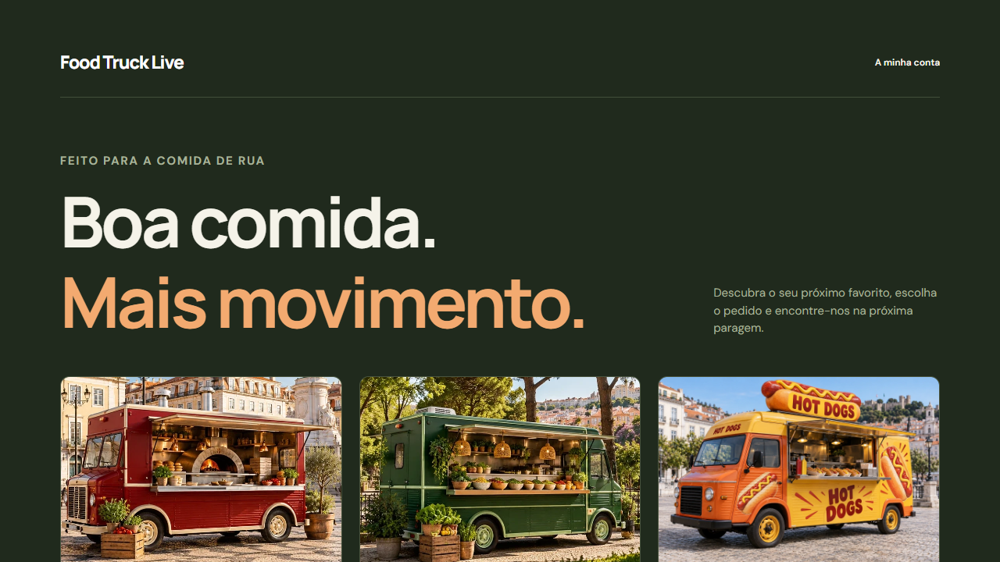

## 2. Entrar e escolher o negócio
1. Abra o endereço da gestão no navegador.
2. Introduza o email e a palavra-passe entregues pelo administrador da instalação.
3. Depois de entrar, confirme o nome da área e o email em «Sessão».
4. No campo «Negócio», escolha a carrinha em que pretende trabalhar. Confirme sempre este campo antes de alterar produtos, stock ou encomendas.
5. Use «Terminar sessão» quando acabar, sobretudo num monitor partilhado.

Se se esqueceu da palavra-passe, use «Recuperar palavra-passe». O envio depende do serviço de email configurado pelo instalador. Não partilhe códigos de recuperação ou a palavra-passe com a equipa.

As opções disponíveis dependem das permissões. Se um menu não aparece, peça ao administrador que verifique o acesso. A aplicação pode abrir diretamente a área Rede quando a conta gere toda a organização.

Na primeira instalação, o comando de bootstrap cria uma conta individual definida pelo instalador. Não há uma palavra-passe universal para novas instalações. As credenciais de demonstração antigas não devem ser usadas em produção.

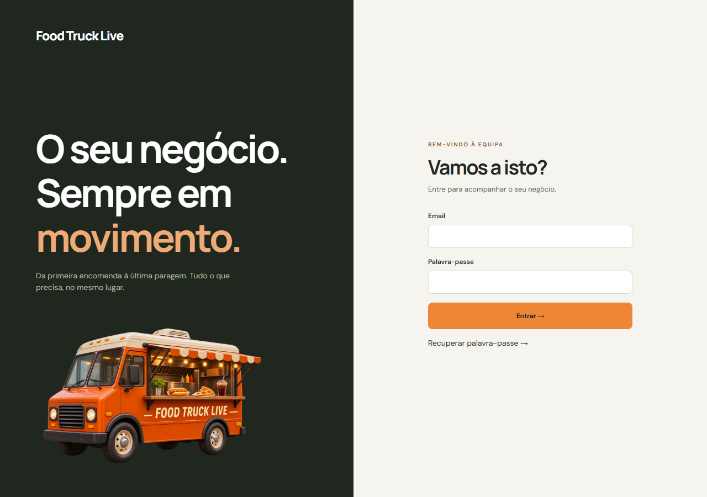

## 3. Layout Atual e modo Touch
Nas áreas «Encomendas», «Menu digital», «Página de encomendas» e «Inventário», encontra «Modo de utilização» no topo.

| Opção | Quando usar |
| Atual | Trabalhar com rato e teclado, mantendo a apresentação habitual. |
| Touch | Trabalhar com o dedo num monitor, tablet ou outro ecrã tátil. |

1. Entre numa destas áreas.
2. Carregue em «Touch» para ampliar botões, campos, texto e espaçamento.
3. Nas listas, os dados reorganizam-se para facilitar a leitura e o toque.
4. Carregue em «Atual» para regressar ao layout habitual.

O modo Touch usa controlos com pelo menos 52 px nas áreas abrangidas. Em ecrãs menores, a navegação passa para uma barra horizontal; deslize a barra para encontrar as restantes opções.

A escolha fica guardada neste navegador e aplica-se às quatro áreas. Não muda a apresentação do menu dos clientes, não altera as permissões e não muda dados. Noutro computador ou navegador, escolha novamente. O zoom e a limpeza dos dados do navegador podem afetar a preferência.

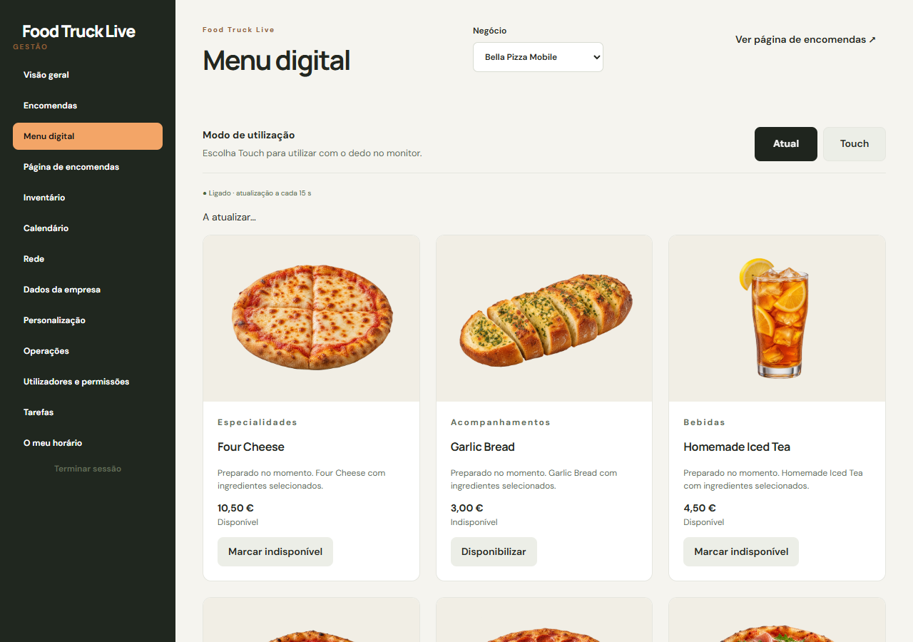

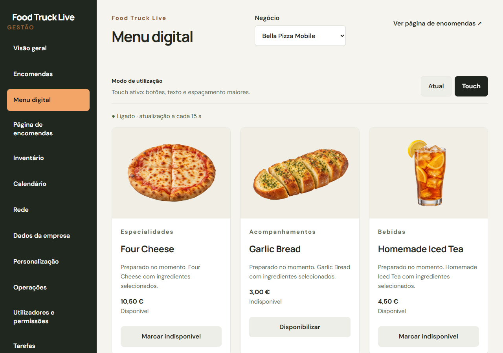

## 4. Criar e apresentar uma carrinha
A conta com acesso à rede pode criar um negócio em «Rede > Negócios». Preencha o nome, endereço do menu e cor. Depois de criar, complete a apresentação no editor.

O endereço do menu, também chamado slug, identifica a carrinha no URL. Use letras minúsculas sem acentos, números e hífen. Exemplo: nome «Hot Dog Street», slug «hot-dog-street». «Hot Dog» não é válido porque contém espaço e maiúsculas. Cada slug tem de ser único.

Em «Página de encomendas», escolha «Editar página». Pode preencher a descrição, contacto, fotografia da carrinha, logótipo, cores, redes sociais e outros dados disponíveis. Confirme o negócio selecionado antes de guardar.

| Imagem | Preparação recomendada |
| Fotografia da carrinha | Imagem horizontal, veículo completo e boa iluminação. |
| Logótipo | PNG ou WebP com transparência real, se pretender fundo transparente. |
| Produtos | Recorte limpo e transparente quando esse é o estilo do menu. |

O editor aceita PNG, JPEG e WebP até 3 MB. JPEG não suporta transparência. Uma grelha desenhada numa imagem não é transparência: o ficheiro precisa de canal alfa.

Guarde com «Guardar e publicar alterações» e abra a página de encomendas para confirmar. Os ficheiros da pasta UPLOADS são recursos preparados para inserção manual; estar nessa pasta não publica automaticamente uma imagem ou um produto.

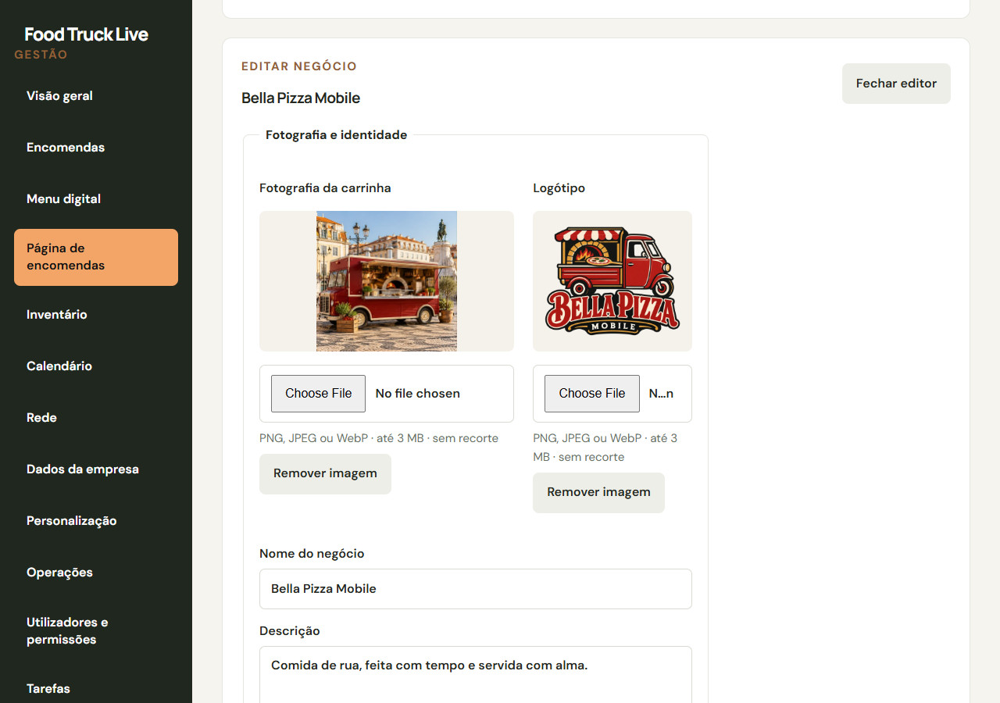

## 5. Menu digital e produtos
Em «Menu digital», confirme a carrinha e consulte os produtos. «Marcar indisponível» retira a disponibilidade do produto; «Disponibilizar» permite voltar a vendê-lo, sujeito ao stock e às restantes regras. A ação mantém a ordenação por nome.

No formulário «Criar ou editar produto», escolha «Criar novo» ou selecione um produto existente. Preencha os campos do formulário e guarde. Para editar um produto, confirme o registo selecionado antes de escrever.

Os preços dos campos técnicos identificados como cêntimos usam números inteiros: 650 significa 6,50 EUR. O preço apresentado ao cliente é formatado em euros. Use uma descrição clara e identifique os alergénios aplicáveis.

Pode carregar uma fotografia e removê-la no editor. A imagem é guardada com as alterações do produto. Não carregue ficheiros enormes; prepare a imagem antes de enviar.

Categorias, receitas, ingredientes, grupos de opções, tamanhos e extras são configurados nas áreas de operação correspondentes, conforme as permissões. Uma receita liga um produto a ingredientes para controlar reservas e consumo de stock. Confirme quantidades e unidades antes de começar a vender.

Depois de guardar, consulte o menu público e confirme nome, preço, imagem e disponibilidade. Em alojamento com atualização periódica, aguarde o próximo ciclo ou atualize a página. Uma falha de rede não confirma que a operação foi guardada: verifique antes de a repetir.

## 6. Página de encomendas
A área «Página de encomendas» reúne atalhos para a página dos clientes, identidade e menu do negócio.

1. Escolha «Editar página» para alterar fotografias, logótipo e apresentação.
2. Escolha «Editar menu» para ir aos produtos.
3. Escolha «Abrir página de encomendas» para verificar o resultado público.
4. «Abrir catálogo de negócios» mostra a página inicial com as food trucks disponíveis.

O modo Touch desta área amplia o editor de gestão. Os visitantes continuam a ver o menu público normal.

Um negócio arquivado pode manter dados históricos e permitir editar a identidade, mas tem de ser reativado na rede para publicar novamente a página. Não confunda arquivar um negócio com tornar um produto indisponível.

Ao mudar fotografias, valide os dois contextos: cartão da carrinha na página inicial e imagem dentro do seu menu. As fotografias de carrinhas têm apresentação horizontal; as fotografias de produtos usam o seu tratamento próprio.

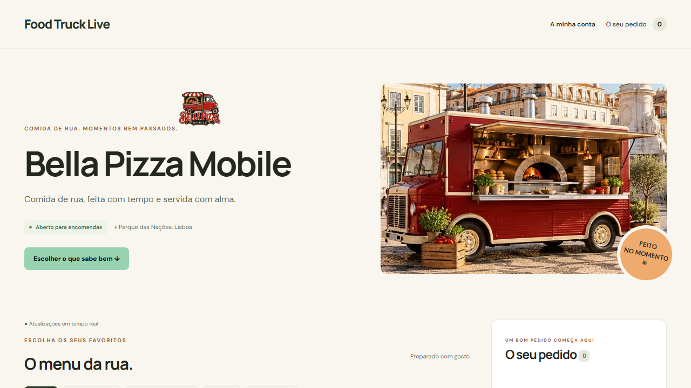

## 7. Inventário e ingredientes
Em «Inventário», pode pesquisar por ingrediente ou fornecedor, filtrar ativos, stock baixo, esgotados e removidos, e ordenar por nome ou menor disponibilidade.

| Campo | Significado |
| Stock total | Quantidade fisicamente registada. |
| Reservado | Quantidade comprometida em encomendas ainda não consumida. |
| Disponível | Stock total menos reservado. |
| Mínimo | Limiar que sinaliza necessidade de reposição. |

«Adicionar ingrediente» cria nome, unidade, quantidade inicial, mínimo e fornecedor. As quantidades são inteiras; para frações de quilograma use gramas e para frações de litro use mililitros. Não misture unidades nas receitas.

«Editar» altera os dados do ingrediente. «Registar movimento» regista uma reposição, desperdício ou correção. Introduza uma quantidade positiva e escolha a direção quando o formulário a pedir. Consulte «Histórico» para perceber as variações.

«Remover» pede confirmação e preserva o histórico. A remoção só é aceite quando o stock está a zero e não existem reservas, receitas, extras ou transferências pendentes que a impeçam. Se for recusada, resolva primeiro a dependência indicada; não tente contornar o controlo.

Para recuperar um ingrediente removido, escolha «Mostrar > Removidos» e «Restaurar». A equipa deve conferir fisicamente o stock e registar correções justificadas. O sistema protege reservas para evitar retirar ingredientes já comprometidos.

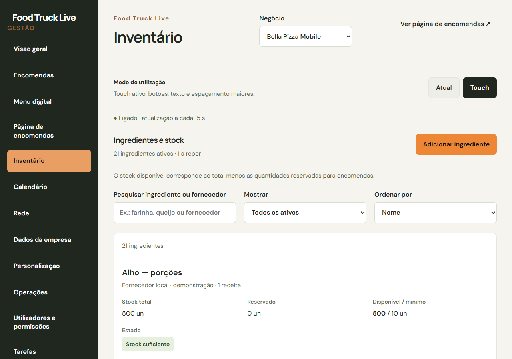

## 8. Eventos, moradas e mapa
Em «Calendário», crie ou edite um evento. Escolha a carrinha, título, nome do local, morada, início, fim e publicação. O nome do local é uma designação reconhecível, como «Parque das Nações»; o título identifica a iniciativa.

Pode escrever a morada manualmente ou selecionar um ponto no mapa. O mapa gratuito permite procurar e ajustar o pin. Confirme sempre o resultado; locais com nomes semelhantes podem devolver outro sítio. Também pode fornecer coordenadas ou uma referência Google Maps conforme os campos do editor.

Use latitude e longitude em graus decimais, por exemplo 39.548264 e -8.981038. Uma morada sem coordenadas pode ser apresentada como texto e aberta no Google Maps, mas não garante um pin no mapa interno.

Verifique a data, a hora e o fuso de Portugal continental. O fim deve ser posterior ao início. Publique para que o evento possa aparecer aos clientes; um rascunho fica reservado à gestão. Após criar com sucesso, a janela fecha automaticamente. Se houver erro, corrija-o antes de tentar de novo.

Na página inicial dos clientes, «Onde estamos agora» mostra pontos publicados. Um evento em curso tem prioridade sobre a localização manual da carrinha. Se não existe localização atual publicada, um evento futuro pode aparecer como «Próxima paragem», com início e fim, sem ser confundido com uma presença atual.

Alterar o evento ou a localização com coordenadas atualiza o pin automaticamente; não é preciso pedir à IA para redesenhar o mapa. A página consulta alterações a cada 15 segundos enquanto está ativa e ligada à internet. Isto é atualização da localização publicada, não rastreio GPS contínuo do veículo.

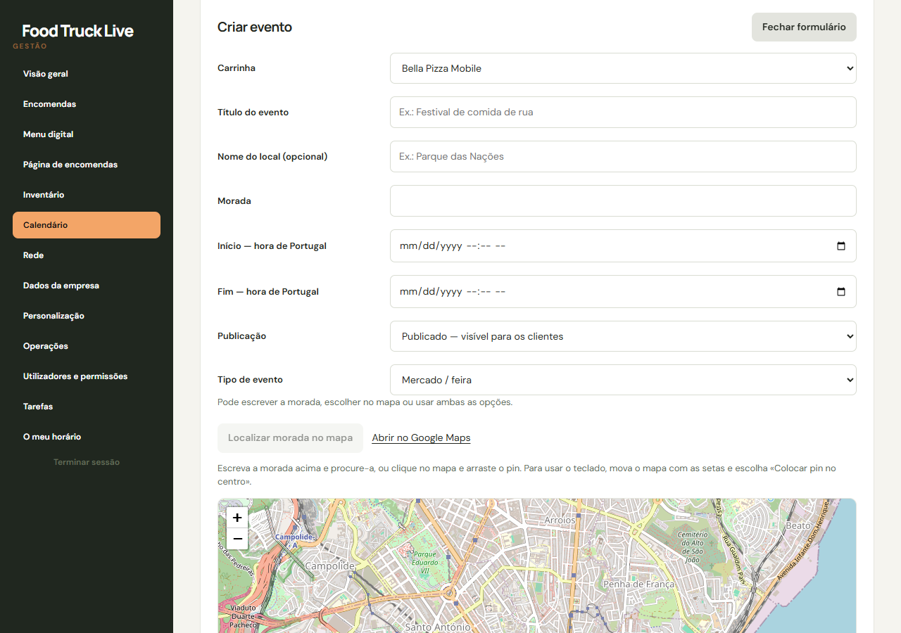

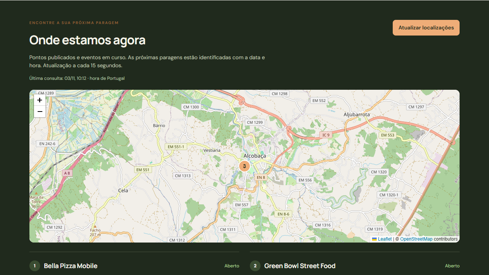

## 9. Trabalhar com encomendas
Escolha «Encomendas» e a carrinha correta. Pode alternar entre «Cartões» e «Lista», agrupar por dia de recolha ou evento, filtrar por estado e pesquisar por número, cliente, artigo ou evento.

O número permite identificar a encomenda no atendimento. Confirme também os artigos, escolhas, hora de recolha, evento e pagamento. Os contactos podem estar ocultos a perfis com acesso limitado.

| Estado | Ação operacional habitual |
| Pendente | Conferir e confirmar, ou cancelar. |
| Confirmada | Começar a preparação quando for adequado. |
| Em preparação | Preparar e marcar pronta quando terminar. |
| Pronta a recolher | Entregar ao cliente e confirmar a recolha. |
| Recolhida | Processo concluído. |
| Cancelada | Não preparar nem entregar; verificar o motivo. |

As reservas de ingredientes e o consumo são controlados pelo servidor. Cancelamentos depois de consumir ingredientes podem representar desperdício. Não altere diretamente a base para corrigir o estado: use as ações disponíveis e consulte o histórico.

Se a encomenda pronta está por pagar, use «Registar pagamento» depois de receber o valor. Pagamento real na recolha e pagamento de demonstração são apresentados separadamente.

Não marque «Recolhida» apenas porque a comida está pronta. Esse estado confirma que já foi entregue. Pedidos pendentes podem expirar de acordo com as regras do sistema; confirme-os atempadamente.

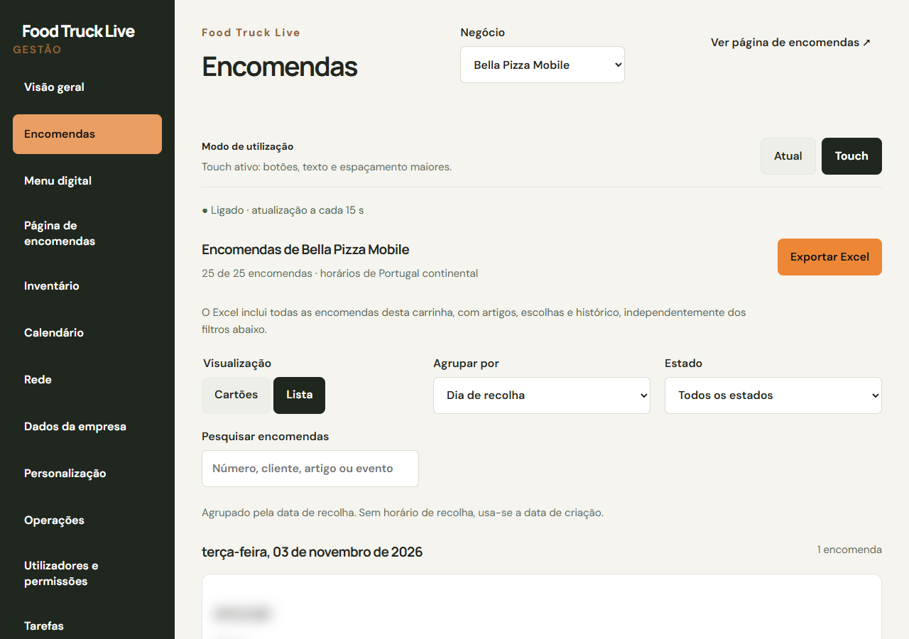

## 10. Exportar para Excel
Em «Encomendas», carregue em «Exportar Excel». Aguarde a preparação e guarde o ficheiro .xlsx descarregado pelo navegador.

A exportação inclui todas as encomendas da carrinha selecionada, independentemente da pesquisa, agrupamento ou filtro mostrado no ecrã. Inclui dados da encomenda, artigos, escolhas e histórico disponíveis para a conta.

1. Confirme o nome da carrinha antes de exportar.
2. Abra o ficheiro no Excel ou num programa compatível.
3. Analise as folhas e os cabeçalhos antes de filtrar ou calcular.
4. Guarde o ficheiro num local com acesso controlado, pois pode conter dados pessoais.

O Excel não substitui uma cópia da base de dados e das imagens. Também não é um documento fiscal. Para transferir a instalação ou recuperá-la após falha, siga o manual de instalação e cópias de segurança.

## 11. Percurso do cliente
Na página inicial, o cliente escolhe uma carrinha, consulta a sua localização publicada e entra no menu. Adiciona produtos, escolhe opções e confirma o carrinho, dados e recolha disponíveis.

Depois de enviar a encomenda, deve guardar o número e abrir o acompanhamento. Evite reenviar só porque a resposta demorou: confirme primeiro se já existe um pedido.

O cliente pode criar conta e confirmar o email. Se a conta já existe, deve entrar ou recuperar a palavra-passe, em vez de tentar criá-la novamente. «Reenviar confirmação» permite pedir outra mensagem para o email escrito.

Uma encomenda feita como visitante pode apresentar «Associar à minha conta». A associação exige entrar na conta e manter a prova de acesso ao pedido no mesmo navegador. Saber apenas o número não dá acesso a dados privados.

Na conta, o cliente consulta as encomendas, o número e o estado. Enquanto o pedido está ativo, pode acompanhá-lo. Depois de ficar «Recolhida», deixa de aparecer o botão «Acompanhar encomenda», porque o atendimento está concluído.

Se o email não chegar, confirmar o endereço, spam e separadores do correio; depois pedir reenvio e contactar o administrador se persistir. Os emails da aplicação são enviados pela API; mudar definições de Supabase Auth não corrige, por si só, este envio.

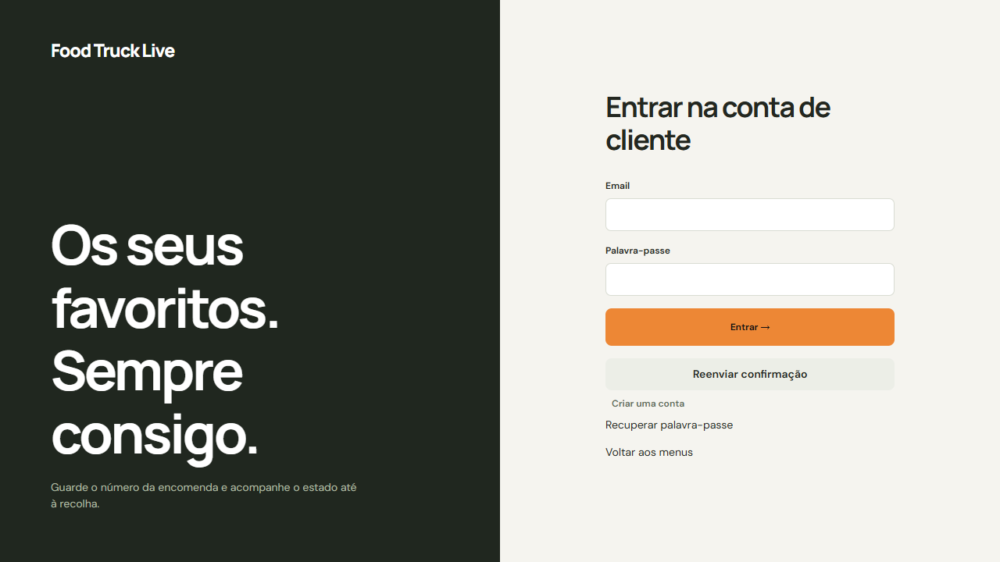

## 12. Rede, equipa e rotinas
A área Rede permite organizar carrinhas e consultar opções de equipa, horários, modelos de menu e transferências. Só administradores autorizados devem criar negócios e conceder permissões.

Conceda apenas o acesso necessário a cada pessoa. Um colaborador que prepara encomendas não precisa, por isso, de gerir toda a identidade da organização ou os utilizadores. Cada pessoa deve ter a sua própria conta.

Tarefas e «O meu horário» ajudam a organizar o serviço, conforme as permissões. Antes de um evento, confirme a carrinha, equipa, menu, ingredientes, local e hora.

Rotina antes de abrir: conferir stock físico, corrigir indisponibilidades, confirmar evento/localização e abrir o menu público como cliente. Fazer uma encomenda de ensaio claramente identificada, se necessário.

Rotina ao fechar: concluir ou cancelar os pedidos pendentes de acordo com o atendimento real, conferir pagamentos e movimentos, atualizar a abertura/localização e terminar sessão nos monitores partilhados. O responsável técnico deve verificar backups e alertas do alojamento.

## 13. Resolver problemas frequentes
| Situação | O que verificar |
| «Invalid input» ou formato inválido | Campo obrigatório, slug sem espaços, números, limites e URL onde exigido. |
| Imagem não aparece | Guardar o editor, confirmar ficheiro suportado e até 3 MB, abrir menu público; pedir verificação do storage se persistir. |
| Evento não aparece | Carrinha correta, publicação, data/hora, coordenadas e se é atual ou próxima paragem. |
| «A reconectar às atualizações» | Internet e API. Em modo periódico, a indicação normal é «Ligado - atualização a cada 15 s». |
| Alteração não fica guardada | Ler o erro e atualizar a lista antes de repetir; outra pessoa pode ter alterado o mesmo registo. |
| Ingrediente não pode ser removido | Stock, reservas e dependências de receitas, extras ou transferências. |
| Não chega confirmação de email | Email correto, spam, reenvio e configuração/limite do fornecedor de email. |
| Encomenda de outro navegador inacessível | Entrar na conta associada; o número sozinho não autoriza acesso. |

Ao pedir ajuda, indique a área, carrinha, ação, hora, mensagem e número da encomenda se aplicável. Não envie palavras-passe, chaves API ou códigos de recuperação. Um ecrã com dados pessoais deve ser partilhado apenas com quem pode prestar suporte.

## 14. Instalar como atalho e usar com segurança
Abra o site em HTTPS. Quando o navegador disponibilizar «Instalar aplicação» ou «Adicionar ao ecrã principal», use essa opção para criar o atalho. No iPhone/iPad, procure a opção no menu de partilha do Safari; no Android e desktop, consulte o menu do navegador.

A disponibilidade e o aspeto dependem do navegador e do sistema operativo. Esta é uma aplicação web; não é um instalador nativo de Windows, macOS, Android ou iOS.

O atalho não instala a base de dados no dispositivo. A gestão, as encomendas e as alterações de stock precisam de ligação ao servidor. Não assuma que encomendas feitas sem internet serão enviadas mais tarde.

Mantenha o navegador atualizado, use bloqueio de ecrã e confirme o endereço antes de entrar. Em equipamentos partilhados, termine sessão quando acabar. Para instalar o servidor, migrar dados ou mudar de alojamento, consulte o manual de instalação que acompanha esta edição.
